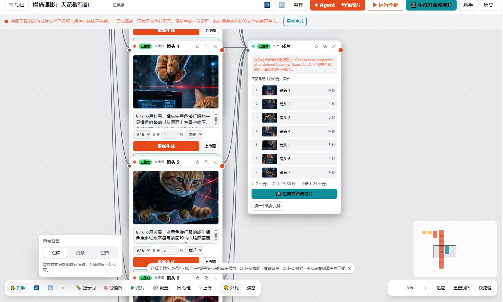
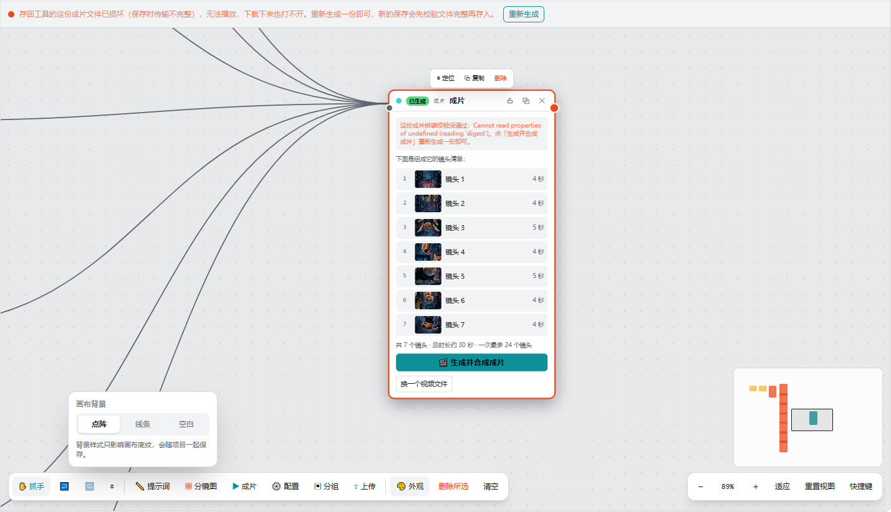

# Muse InfiniteReel · 无限影卷

> 一块无限画布，一条从创意到成片的完整流水线。
> 类 LibTV 的无限画布视频创作工作台：手动节点工作流与 Agent 一句话成片双模式并存，文本、图像、视频生成全部由 Muse 驱动，使用者不需要任何 API Key。



---

## 目录

- [它是什么](#它是什么)
- [他人如何使用](#他人如何使用)
- [主要功能](#主要功能)
- [运行截图](#运行截图)
- [实现框架](#实现框架)
- [核心原理](#核心原理)
- [数据模型](#数据模型)
- [服务端动作（Actions）](#服务端动作actions)
- [如何扩展](#如何扩展)
- [目录结构](#目录结构)
- [运行环境说明](#运行环境说明)
- [设计取舍与已知限制](#设计取舍与已知限制)
- [版本沿革](#版本沿革)

---

## 它是什么

Muse InfiniteReel 是一个运行在 Muse 托管运行时上的全栈 Web 应用（TypeScript），面向短视频/短片创作：

- 创作者在一块**无限画布**上用节点和连线搭建工作流：创意文本 → 剧本 → 分镜图 → 成片，全部可手动逐步调整；
- 也可以只说**一句话**，由 Agent 在后台自动完成搭工作流、写剧本、资产定版、逐镜头分镜、逐镜头真运动视频、配乐、剪辑合成，直接交付成片；
- 所有生成（生文 / 生图 / 图生视频 / 配乐）都由 Muse 用自身能力在后台完成，工具内**没有**任何填 Key 的地方。

它与同类开源画布（如 infinite-canvas）最大的路线区别：**服务端存储 + 服务端编排 + 后台任务生成**，而不是本地存储、自备 Key、浏览器直连模型。本仓库的画布层在 2026-11-11 按 infinite-canvas（MIT）的引擎实现逐项对照移植了交互与操作手感，生成与存储路线则保持本项目的服务端架构。

## 他人如何使用

先说清一个事实：这个工具运行在作者本人的 Muse 托管环境里，项目数据与生成能力都绑定作者的 Muse 账号，**没有对外的公共访问链接**，所以没法像普通网站那样打开就用。其他人想用，有三条路：

### 路径一：普通用户——在自己的 Muse 里拥有一个同款工具（推荐）

这个工具本身就是作者用自然语言让 Muse 构建并托管运行的。任何 Muse 用户都可以让自己的 Muse 照着本仓库的蓝图复刻一个属于自己的版本：

1. 打开自己的 Muse，把本仓库链接发给它；
2. 这样对它说（可直接照抄改词）：

   > 请参照这个仓库（Muse InfiniteReel）的功能与架构，为我构建一个同样的无限画布视频生成工具：无限画布 + 文本/图像/成片节点 + Agent 一句话成片，生成全部走你自己的能力，我不提供任何 API Key。

3. 建好后就是你的专属实例，项目和数据都在你自己的环境里，互不干扰。

**上手使用（手动模式）**：新建项目 → 在画布上添加「分镜图」节点，写画面提示词（或先加「提示词」节点让 AI 扩写/写分镜脚本，一键拆成镜头节点）→ 逐镜头点生成出分镜图，不满意的单张重生成或用精修工具调整 → 添加「成片」节点，把镜头按剧情顺序连入 → 点「生成并合成成片」，等后台逐镜头生成视频、剪辑完成，成片会回到成片节点里，可直接播放和下载。

**上手使用（Agent 模式）**：点顶栏「Agent 一句话成片」→ 输入一句话创意，按需选时长/画幅/风格 → 选「全自动直达」就等成品；选「分步确认」则在分镜图生成后先检查、改图，再点继续生成成片。

### 路径二：开发者——Fork 本仓库，迁移到自己的运行时

画布引擎层是纯前端实现（React + TypeScript，无第三方画布库），可以直接搬运复用；需要替换的是它依赖 Muse 运行时的三层接口：

| 平台层 | 本仓库中的位置 | 迁移时可替换为 |
| --- | --- | --- |
| 服务端动作与数据 | `server/src/actions.ts`、`server/src/schema.ts`、`drizzle/` | 任意后端框架 + 数据库，按 Actions 清单逐个实现同名接口 |
| 文本/图像生成 | 页面调用平台推理接口 | 任意 LLM / 生图 API（OpenAI 兼容接口等），在动作层做薄封装 |
| 媒体存储 | 平台 Blob（库里只存引用键） | S3 / OSS / 本地文件服务，保持「库里只存键」的约定 |
| 成片后台任务 | Muse 后台任务按 `film_requests` 协议领取执行 | 自建任务队列 + Worker：图生视频 API（如各厂商的视频生成接口）逐镜头生成 + ffmpeg 剪辑/烧字幕/混音，再按本仓库的分片 + 哈希封存机制回存 |

迁移时请保留三条已验证的可靠性设计：文件交付走「落盘 + 服务端自读 + 分片哈希封存」，不要用大参数传输文件；服务端保存遵守「非空媒体不被空值覆盖」；长任务必须有进度心跳与超时自检。

### 路径三：贡献者

欢迎提 Issue 和 Pull Request：修 bug、补文档、加节点类型或生成模式都可。动手前建议先读「如何扩展」一节与仓库根目录的 `AGENTS.md`（构建约束），以及 `DATA-PLAN.md`（数据层设计）；涉及成片管线的改动请同时说明对心跳/超时/封存校验的影响。

## 主要功能

### 无限画布（引擎层）

- 单一视口状态 `{x, y, k}`，节点按世界坐标绝对定位，容器整体 CSS 变换，移动视口零重排
- 滚轮以**鼠标为锚点**的指数缩放（0.05×–5×）；空格/Ctrl 临时抓手、中键平移、选择/抓手工具切换；拖动与平移均用 Pointer Capture + `requestAnimationFrame` 节流
- 连线为 SVG 三次贝塞尔曲线（曲率 `max(dx × 0.5, 50)`），叠加 16px 透明热区方便点选；连线合法性统一收口（防自连、防重复、方向规范化）
- 事件路由采用 DOM 标记法（`data-node-id` / `data-connection-id` / `data-canvas-no-zoom`），快捷键对 `input / textarea / select / contenteditable` 全面豁免——在节点里编辑文字时 Backspace 只删字，删节点只认 Delete
- 选区：框选、Shift/Ctrl/Cmd 点选加减选、Ctrl/Cmd+A 全选、Esc 清除、多选整体拖动、选区浮动工具条
- 历史：撤销/重做双栈（上限 50）、提交防抖（连续拖动不刷栈）、回放防重复入栈、条目含视口；图片/成片等资产引用随节点数据保留，撤销不丢图
- **分组节点**：Ctrl/Cmd+G 成组、Ctrl/Cmd+Shift+G 解组，组包围盒自动包裹成员（内边距 24 / 顶部 52），节点可拖入拖出、整组移动、折叠/解散
- 相机聚焦 `focusViewportForNode`：一键把视角定位到任意节点；Agent 搭建/成片完成时自动聚焦成片节点；手机首次打开自动适应全工作流
- 小地图 240×160：全体节点包围盒外扩 500 后等比缩放，视口框可拖拽跳转
- 三种画布背景（点阵 / 线条 / 空白）、底部工具坞、右下缩放簇（含适应全部、重置视图）、节点悬停工具条、节点状态徽标（生成中/失败/已生成）、双击标题重命名

### 节点与生成

- 节点类型：文本（创意/剧本）、图像（分镜图/资产图）、视频/成片、**生成配置**（新增）、分组
- 生文 4 种模式：扩写提示词、短视频脚本、分镜脚本、标题文案；分镜脚本可一键拆成连好的镜头节点 + 成片节点
- 生图：文生图、图生图（看图改图）、变体生成，画幅 16:9 / 9:16 / 1:1
- **生成配置节点**：连入的下游生成节点统一继承其画幅/画质/风格参数，改一处全组生效；Agent 自动搭建时自动生成全局配置节点
- **生成上下文沿连线收集**：生成时自动把上游文本、配置风格、上游图片信息合并进提示词
- **生成快照与原样重试**：每次生成把提示词、画幅、时长、运镜、质量、参考图、风格快照存入节点，节点上「⤺ 原样重试」一键按快照重跑
- 单图精修五件套：裁剪（四边百分比 + 像素级处理）、切分 2×2 生成四个新节点、超分放大、多角度（六种机位改写提示词再图生图）、蒙版编辑（涂抹标注区域 + 文字指令引导重绘）
- 项目管理：多项目、生成历史、项目包导入/导出（JSON + 资源键清单；导入时资源按原键复用、同名新上传自动重映射）

### 一键成片与 Agent 一句话成片

- **手动成片**：成片节点汇总所有连入的镜头，点击「🎬 生成并合成成片」后，后台逐镜头按剧情生成真运动视频片段，烧录字幕、按剧情剪辑合成，最终成片回存到成片节点与生成历史
- **Agent 模式**：顶栏输入一句话创意（可附目标时长/画幅/风格），自动新建项目并分区搭好工作流——输入节点 → 剧本节点（含完整分镜表与配乐基调）→ 资产定版参考图（统一角色/风格锚点文本注入每一个镜头提示词）→ 逐镜头分镜图 → 成片节点；两种节奏：
  - **全自动直达**：搭完直接进入成片管线，含按剧情基调匹配的背景音乐
  - **分步确认**：分镜图生成后停下等你检查、修改，再点「继续生成成片」（继续时按画布当前状态重新收集镜头）
- **动态进度**：成片横幅与顶栏实时显示阶段（正在写剧本 / 正在定版资产 / 正在生成分镜图 / 正在生成镜头视频 / 正在配乐 / 正在按剧情剪辑合成 / 正在保存成片）、已完成镜头数、已用时间
- **防卡死体系**：后台任务开工即上报进度、长镜头约每 3 分钟心跳；5 分钟无进展页面警告（可手动结束/重来）、15 分钟无进展自动判失败并写明原因、45 分钟总上限自动收尾；页面打开项目时也会把残留的「生成中」状态复位，与服务端自检形成双保险
- **选区感知助手**：顶栏「助手」侧边面板实时带入当前选区及其上游节点作为上下文，可对话、扩写，回复一键插入画布成为新节点

## 运行截图

> 截图为工具在 Muse 运行时中的真实运行界面。

| 画布总览：分镜节点连入成片节点 | 成片节点：7 个镜头汇总（约 30 秒） |
| --- | --- |
|  |  |

分镜节点特写（画幅/时长/运镜、图生图变体、单图精修五件套、视频运动提示词与字幕）：


## 实现框架

```
┌────────────────────────────────────────────────────────┐
│  浏览器（React 客户端）                                  │
│  画布引擎：视口/节点/连线/选区/历史/分组/小地图/聚焦      │
│  节点卡片 · 工具坞 · 缩放簇 · 助手面板 · 进度横幅         │
└──────────────┬─────────────────────────────────────────┘
               │ 类型化 Actions（client/src/api.ts）
┌──────────────▼─────────────────────────────────────────┐
│  服务端（TypeScript Actions + Drizzle/SQLite）          │
│  项目/生成历史的读写 · 保存合并保护 · 成片请求队列        │
│  成片分片导入与封存 · Agent 运行状态机 · 卡死自检         │
└──────────────┬─────────────────────────────────────────┘
               │ 请求/进度协议（film_requests / agent_runs）
┌──────────────▼─────────────────────────────────────────┐
│  Muse 后台任务（编排者）                                 │
│  读项目与镜头表 → 逐镜头生成真运动片段（图生视频）        │
│  → 配乐 → ffmpeg 按剧情剪辑 + 烧字幕 → 写交付文件         │
│  → 小调用触发服务端导入（分片 + 哈希封存）               │
└────────────────────────────────────────────────────────┘
```

- **前端**：React + TypeScript（`client/src`），画布为自研引擎（无第三方画布库），状态保存在服务端而不是浏览器本地。
- **服务端**：一组声明式 Actions（`server/src/actions.ts`）+ Drizzle schema（`server/src/schema.ts`）与 SQL 迁移（`drizzle/0001`–`0006`）；媒体文件走平台 Blob 存储，数据库只存引用键。
- **生成**：页面内的生文/生图走平台推理接口；成片这种长任务不放在页面里，而是落成数据库里的一条「成片请求」，由 Muse 后台任务按协议领取、执行、回报进度、交付。

## 核心原理

### 1. 画布引擎

视口是单一状态 `{x, y, k}`（平移 + 缩放）。节点存世界坐标，渲染时容器做一次 `translate(x, y) scale(k)` 变换，因此平移缩放不需要逐个节点重排版。滚轮缩放先把鼠标点换算成世界坐标，缩放后反推平移量，保证鼠标下的点不动（锚点缩放）。所有指针手势用 Pointer Events + 指针捕获，移动事件经 `requestAnimationFrame` 合并提交，避免高频重渲染。

连线是独立 SVG 层里的三次贝塞尔路径：控制点横向偏移取 `max(|dx| × 0.5, 50)`，曲线自然平滑；每条连线另画一条 16px 宽的透明路径作为点击热区。连线的增删改全部经过一个合法性函数收口，杜绝自连与重复边。

历史记录用 past/future 双栈实现，关键在三点：连续操作（拖动、打字）经防抖合并成一条；程序化回放（撤销本身、后台刷新）带标志位，不会把回放动作再次入栈；历史条目是节点与连线的完整快照，媒体资产只存引用键，所以撤销/重做不会复制大文件、也不会把已生成的图片弄丢。

### 2. 生成编排：为什么成片要走后台任务

页面内的模型调用只能做文本和图像，没有图生视频；真运动视频只能由 Muse 在后台用自己的视频生成能力逐镜头完成。因此成片被设计成一条**请求—执行—交付**协议：

1. 页面点击成片 → 服务端写入 `film_requests`（含镜头清单快照：顺序、提示词、时长、运镜、字幕、画幅）；
2. Muse 后台任务领取请求，按剧情逐镜头生成真运动片段（每镜头先按提示词重建关键帧再图生视频——因为画布里的图片文件本体在 Blob 存储中，后台只能读到镜头的文字信息，这也是成片画面与分镜图会有细微差异的原因，产品内已如实说明）；
3. 用 ffmpeg 按剧情顺序剪辑、烧录字幕、混入配乐，编码出交付版；
4. 交付不走「把文件内容当参数回传」——这条通道在实践中被证明不可靠（整文件一次回传会丢内容，分片回传也会丢片）。最终机制是：后台任务把成片写到宿主机固定路径，只发一个很小的「导入」调用；**服务端自己去读文件**，按 32KB 切片、逐片验 SHA-256 后入库，全部到齐且总字节数与整文件哈希都对得上才封存（`film_assemblies` + `film_chunks` 两张表）；
5. 浏览器播放/下载成片时把分片拉回本地拼装，并再次校验长度、哈希与 MP4 结构（`client/src/filmAssembly.tsx`），任何一环对不上都不会给出一个坏文件；入库前服务端还做 MP4 结构完整性校验，截断/损坏的文件直接拒绝并报错，而不是存下来再让用户下载到错误文件。

### 3. 可靠性：三层防线

- **保存合并保护**：客户端自动保存与服务端回写（后台任务写图片/成片）可能并发，服务端保存采用「已有非空媒体字段永不被空值覆盖」的合并规则，并按节点逐个以最新图数据合并，杜绝旧快照盖掉新生成的图片；
- **加载状态隔离**：画布「已加载」状态只由加载逻辑管理，后台进度刷新只取数据不碰加载标志，避免刷新把画布误判为未加载而卡在加载遮罩上；
- **卡死自检**：见上文防卡死体系——进度心跳、阶段超时与总上限在服务端 `getFilmStatus` 读取时顺带判定（读时自愈），不依赖额外的定时任务。

### 4. 一致性：资产定版

多镜头短片最难的是角色与画风不漂移。Agent 模式在分镜之前先生成一张**资产定版图**，并把统一的角色/风格锚点描述注入每一个镜头的图片提示词；手动模式下可用**生成配置节点**承载全局风格，配合「沿连线收集上游上下文」，让批量镜头共享同一套参数与风格词。

## 数据模型

| 表 | 用途 |
| --- | --- |
| `projects` | 项目：名称 + 整张画布图（节点/连线/视口的 JSON） |
| `generations` | 生成历史：每次生文/生图/成片的记录与产物引用 |
| `film_requests` | 成片请求：镜头清单快照、阶段进度、已完成数、心跳与尝试次数、终态原因 |
| `agent_runs` | Agent 一句话成片运行：状态机阶段、关联项目与成片请求 |
| `film_assemblies` | 成片封存登记：总字节、整文件 SHA-256、片数、状态 |
| `film_chunks` | 成片分片：序号 + 分片数据 + 分片 SHA-256 |

画布图（graph JSON）是节点的唯一真相：节点字段含类型、位置、尺寸、业务参数与最近一次生成的参数快照；媒体只存 Blob 引用键。

## 服务端动作（Actions）

项目与生成：`createProject` `deleteProject` `getProject` `saveProject` `listProjects` `listGenerations` `generateText` `enhancePrompt` `generateImage` `varyImage` `uploadAsset`

成片管线：`requestFilm` `getFilmStatus` `getFilmRequest` `reportFilmProgress` `cancelFilm` `beginFilmSave`（分片登记）/ 宿主机导入 `importFilmFromWorkspace` `failFilmSave`

Agent 管线：`startAgentProduction` `buildAgentProduction` `getAgentRunStatus` `reportAgentProgress` `continueAgentProduction` `cancelAgentRun`

助手：`assistantChat`（与生文同为平台推理的薄封装，额外接收选区上下文）

## 如何扩展

### 加一种节点类型

1. 在 `client/src/types.ts` 的节点类型与字段定义中登记新类型与默认参数；
2. 在 `client/src/NodeCard.tsx` 增加该类型的卡片渲染与工具条按钮，在 `App.tsx` 的创建菜单/工具坞中加入口；
3. 若需要生成能力，在 `server/src/actions.ts` 增加对应 action，并在节点的生成快照字段中记录其参数（这样原样重试自动可用）；
4. 若它要参与成片，在 `requestFilm` 的镜头收集逻辑中定义它如何被收集（顺序键、时长、字幕来源）。

### 加一种生成模式（生文/生图）

- 生文：在服务端 action 中增加模式分支（系统提示词模板 + 输出后处理），前端模式下拉加一项即可；若输出是结构化分镜表，复用「拆分为镜头节点」的现成解析。
- 生图：新模式若本质是图生图，优先复用现有通道（参考图 + 指令），像「多角度」那样把参数改写成提示词增量，而不是新开接口。

### 改成片管线

- 镜头上限、超时阈值（5/15/45 分钟）、心跳间隔都集中在成片请求的状态判定处，改动时注意页面横幅文案与之一致；
- 交付编码参数（分辨率/码率）在后台任务的剪辑步骤中，交付版目标约 1.5MB 是页面体验与画质的折中，机制本身支持到 64MB；
- 分片大小（32KB）与哈希封存逻辑在服务端导入 action 与 `filmAssembly.tsx` 两端必须同步修改。

### 移植画布引擎到其他项目

画布层与业务的耦合点只有三个：节点数据的类型定义、节点卡片渲染、生成动作调用。把 `App.tsx` 中的视口/选区/历史/连线/分组逻辑与 `NodeCard.tsx` 的外壳抽出，替换节点内容与数据层即可复用；算法细节（锚点缩放、贝塞尔热区、历史防抖、包围盒包裹）都在这两个文件内有完整实现可参照。

### 二次开发注意

- 不要把媒体文件本体塞进数据库或动作参数里传输——本项目的血泪教训：大文本参数通道不可靠，文件交付一律走「宿主机落盘 + 服务端自读 + 分片哈希封存」；
- 任何新增的服务端回写都要遵守「非空媒体不被空值覆盖」的合并规则；
- 新增后台长任务必须接入进度心跳协议，否则会被卡死自检判死。

## 目录结构

```
.
├── client/
│   ├── index.html
│   ├── build.mjs                # 客户端构建脚本
│   └── src/
│       ├── App.tsx              # 画布引擎与主界面（视口/选区/历史/分组/小地图/工具坞）
│       ├── NodeCard.tsx         # 节点卡片：各类型节点的渲染与操作
│       ├── ImageTools.tsx       # 单图精修：裁剪/切分/超分/多角度/蒙版
│       ├── filmAssembly.tsx     # 成片分片在浏览器端的拼装与校验/播放/下载
│       ├── api.ts               # 服务端 Actions 的类型化客户端
│       ├── types.ts             # 节点/画布图/请求等共享类型
│       ├── theme.css            # 主题与画布背景样式
│       └── main.tsx             # 入口
├── server/
│   └── src/
│       ├── actions.ts           # 全部服务端动作（含成片导入封存与卡死自检）
│       ├── schema.ts            # Drizzle 数据模型
│       └── privileged.ts        # 特权通道（宿主机文件导入等）
├── drizzle/                     # SQL 迁移 0001–0006 与迁移日志
├── package.json
└── DATA-PLAN.md                 # 数据层设计说明
```

## 运行环境说明

本项目是为 **Muse 托管运行时**构建的全栈应用：服务端动作、平台推理（生文/生图）、Blob 媒体存储、后台任务编排都依赖该运行时提供的上下文接口，因此它不是一个 clone 下来 `bun install` 就能独立跑起来的普通仓库。发布源码的目的在于：完整呈现产品实现、便于阅读审计、二次开发与向其他运行时迁移。迁移时需要替换的正是上文「实现框架」图中的三层接口：Actions 层、媒体存储、生成/后台任务通道；画布引擎层是纯前端实现，可直接搬运。

## 设计取舍与已知限制

- **不做假视频**：明确拒绝静态图推拉/淡化、逐帧变形、光流插帧等把静图拼成「像在动」的做法；每个镜头必须是真图生视频片段再按剧情剪辑。
- **成片画面与分镜图会有细微差异**：后台任务读不到 Blob 中的分镜图本体，只能按提示词重建关键帧，产品内已向使用者如实说明。
- **蒙版编辑**是「涂抹标注 + 文字指令引导重绘」，平台暂无像素级 inpainting；**超分**是 2 倍平滑放大不新增细节；配置节点的画质档目前作用于提示词细节与快照记录，平台生图接口无独立质量参数——这三处都在 UI 内如实标注。
- **项目包不打包成片原文件**：成片是分片封存的大文件，项目包只记录引用，导入后成片节点为空文件并在导出时列明跳过项。
- 未移植 infinite-canvas 的插件注册表/事件总线与 WebDAV：前者与服务端动作架构冲突且非画布手感必需，后者与服务端存储路线重复。

## 版本沿革

- **2026-11-10** 初版：无限画布 + 文本/图像/视频节点 + Muse 生成。
- **2026-11-10** 操作对齐 LibTV：多选/复制粘贴/对齐分布/自动布局/右键菜单；生图补图生图与变体；确立「分镜在工具、真运动视频由 Muse 后台生成再剪辑」的路线，移除一切静图拼接式合成。
- **2026-11-10** 成片管线成型：逐镜头生成 + 字幕烧录 + 剧情剪辑；镜头上限 24；动态进度；Backspace 不再误删节点。
- **2026-11-10** Agent 一句话成片上线（全自动直达 / 分步确认双模式），含资产定版与配乐。
- **2026-11-10** 可靠性系列修复：卡死自检与心跳、节点图片防覆盖合并与自动回填、画布加载状态隔离、下载损坏根因定位（存入的成片本体截断）与入库前 MP4 完整性校验。
- **2026-11-10** 成片交付结构性重构：宿主机落盘 + 服务端自读分片（32KB）+ 逐片哈希 + 封存校验 + 浏览器拼回校验，实测 1.18MB 成片 36 片导入、重组哈希一致、新请求 3 分钟内端到端完成。
- **2026-11-11** 画布层按 infinite-canvas 逐项对照移植：视口/手势、事件路由标记法、连线热区与合法性、历史防抖双栈、分组节点、相机聚焦、生成快照与原样重试、生成配置节点、上游上下文收集、单图精修五件套、选区感知助手、项目导入/导出、底部工具坞与小地图算法对齐；移动端首次打开自动适应全图。
- 2026-11-11 · 成片校验双通道：页面拼装校验改为双通道哈希（原生 crypto.subtle 优先、内置纯 JS SHA-256 兜底），修复缺少 crypto.subtle 的环境把完好成片误判损坏的问题；校验报错只显示中文，无封存记录的旧成片回退普通播放与下载。
- 2026-11-11 · 画质优先交付：成片交付编码改为质量优先（H.264 CRF 18–20），取消 1.5MB 大小上限，仅保留导入机制的 64MB 上限；新增 replaceFilmFromWorkspace 通道，已封存成片可原子替换为高清版本，失败时旧版不受影响。
- 2026-11-11 · 拖动与整理修复：画布根部拦截 dragstart 与中键 auxclick、节点内媒体与下载链接禁用原生拖拽，修复拖动节点误开新浏览器标签页；「整理」改为分层折行网格布局（列数自适应、上限 6 列），分镜拆分与 Agent 自动搭建同步采用同一网格公式。
- 2026-11-11 · 完整文件直读（迁移 0007）：封存成片在服务端另存完整文件副本，旧成片由 getFilmFile 首次访问时按封存清单核对字节数与整文件 SHA-256 后合并生成；成片节点、完成横幅与生成历史的下载改为完整文件直链（请求数由分片数降为 1），播放改为流式直读，分片拼装仅保留为兜底。
- 2026-11-11 · 节点播放凭确证回退：成片节点查询完整文件未完成时只显示加载状态、查询报错提供重新加载，媒体加载失败对同一直连 URL 延迟重试 4 次；只有服务端明确无完整文件副本或重试耗尽时，才回退分片拼装。
